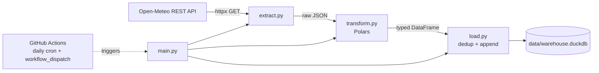

# Automated Weather ELT Batch Pipeline


A local-first, automated batch ELT pipeline that extracts hourly meteorological metrics from the Open-Meteo REST API, transforms them with Polars, and loads idempotent historical records into a persistent DuckDB analytical database. A scheduled GitHub Actions workflow runs the whole thing headlessly every day.

---

## Architecture



### Workflow

1. **Extract:** `src/extract.py` uses `httpx` to pull hourly weather metrics from the Open-Meteo REST API.
2. **Transform:** `src/transform.py` uses Polars for out-of-core, zero-copy manipulation and enforces a clean, explicit DataFrame schema.
3. **Load:** `src/load.py` appends transformed records to a persistent DuckDB database (`data/warehouse.duckdb`), applying deduplication so reruns never create duplicate rows.
4. **Orchestrate:** `.github/workflows/scheduled_elt.yml` runs the pipeline daily on a GitHub-hosted runner, with a manual `workflow_dispatch` trigger as a fallback.

---

## Key Features & Technical Highlights

- **Idempotent ingestion.** The load step deduplicates against records already in the warehouse, so the pipeline can be re-run, retried, or backfilled without corrupting history. This matters most for scheduled jobs, where overlapping API windows and retries are normal.
- **Zero-copy Polars performance.** Polars is built on Apache Arrow's columnar memory format, so transformations avoid unnecessary copies. Handing the result to DuckDB stays cheap because both engines speak Arrow.
- **Embedded analytical store.** DuckDB runs in-process with no server to provision or maintain, while still giving columnar storage and full SQL for analytical queries. The trade-off is single-writer concurrency, which fits a once-a-day batch job well.
- **Headless automation.** The pipeline needs no local machine or long-running server. GitHub runners provide the compute, and the schedule lives in version control next to the code.
- **Simple, testable module boundaries.** Extract, transform, and load are separate modules with a single entrypoint (`main.py`), so each stage can be run and debugged independently.

---

## Directory Layout

```text
local-elt-pipeline/
├── .github/
│   └── workflows/
│       └── scheduled_elt.yml   # Daily cron + manual workflow_dispatch
├── data/
│   └── warehouse.duckdb        # Persistent DuckDB analytical database
├── src/
│   ├── extract.py              # Open-Meteo API extraction (httpx)
│   ├── transform.py            # Polars cleaning and schema enforcement
│   └── load.py                 # Idempotent load into DuckDB
├── main.py                     # Pipeline entrypoint
├── requirements.txt
└── README.md
```

---

## Quickstart

### 1. Clone and create a virtual environment

```bash
git clone https://github.com/<your-username>/local-elt-pipeline.git
cd local-elt-pipeline

python3.11 -m venv .venv
source .venv/bin/activate        # Windows: .venv\Scripts\activate
```

### 2. Install dependencies

```bash
pip install --upgrade pip
pip install -r requirements.txt
```

### 3. Run the pipeline

```bash
python main.py
```

Running it a second time is safe: previously loaded records are skipped.

### 4. Query the warehouse

Using the DuckDB CLI:

```bash
duckdb data/warehouse.duckdb
```

```sql
SHOW TABLES;
SELECT COUNT(*) FROM hourly_weather;
SELECT * FROM hourly_weather ORDER BY 1 DESC LIMIT 10;
```

Or from Python:

```bash
python -c "import duckdb; print(duckdb.connect('data/warehouse.duckdb').sql('SELECT COUNT(*) FROM hourly_weather'))"
```

### 5. Verify idempotency

```bash
python main.py && python main.py
duckdb data/warehouse.duckdb -c "SELECT COUNT(*) FROM hourly_weather;"
# The row count should not grow on the second run if no new data arrived.
```

---

## Automated Orchestration

The workflow in `.github/workflows/scheduled_elt.yml`:

- Runs **daily** on a cron schedule.
- Can be triggered manually from the **Actions** tab via `workflow_dispatch`.
- Installs Python 3.11+, installs `requirements.txt`, and executes `python main.py` on the runner.

To run it manually: **GitHub repo → Actions → Scheduled ELT → Run workflow**.

---

## Tech Stack

| Layer          | Tool                          |
| -------------- | ----------------------------- |
| Language       | Python 3.11+                  |
| HTTP client    | httpx                         |
| Transformation | Polars                        |
| Storage        | DuckDB                        |
| Orchestration  | GitHub Actions                |
| Data source    | Open-Meteo REST API           |